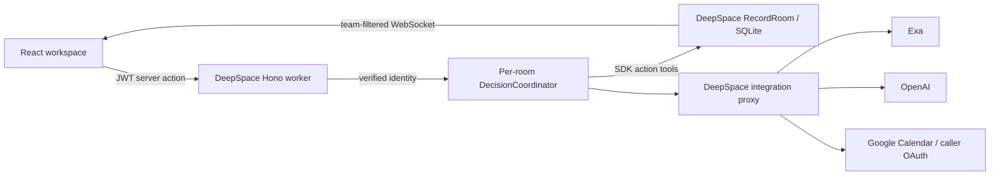

# DecisionRoom

A good decision has receipts. DecisionRoom gives a small group one place to frame a choice, collect sources, compare tradeoffs, vote, and preserve the human reasoning behind the final decision.

Repository: https://github.com/Chenhuan-Tian/decisionroom

Live URL: pending the first verified DeepSpace deployment. Do not treat a guessed app.space hostname as a successful deployment.

## The finished workflow

1. Sign in and create a private room with a question, constraints, and two or three fixed options.
2. The host generates a 24-hour invitation. Joining requires sign-in; sharing an ordinary room URL grants no access. New invitations invalidate previous links. A room holds up to ten people.
3. Members save up to ten HTTPS evidence links with contextual notes. The host can search Exa and review a result before saving it. Notes are user-supplied evidence, not verified claims.
4. The host generates an AI comparison. Every advantage or concern must cite saved evidence for that option; unsupported claims or invalid IDs reject the entire draft. Unknowns remain explicit. Changing evidence makes the old comparison stale. Citation validation checks references, not whether a claim is factually entailed by its source.
5. Each verified user has one changeable vote. Votes are advisory; the host records the final option and rationale. A current comparison can be attached, or the decision can be made manually. Finalization freezes evidence and votes.
6. Export a Markdown decision brief. Optionally create one 30-minute review in the host's primary Google Calendar, after reviewing its time and granting Calendar consent. No attendees or invitation emails are added.

The landing-page book club is explicitly illustrative. User rooms start empty; no fabricated search results or AI output are presented as live data.

## DeepSpace capabilities and integrations

| Capability | Why it belongs here |
| --- | --- |
| Authentication | Verified identity for membership and votes; no app-specific password system. |
| RecordRoom, SQLite collections and realtime subscriptions | Persistent room state shared across users and tabs. |
| Native `teamField` RBAC and `team_members` | Excludes unrelated users before records reach the client. All product writes are action-only. |
| Server actions | Enforce membership, host-only transitions, input limits and referenced-record ownership. |
| A per-room platform Durable Object | Serializes writes and paid calls for a decision, including across asynchronous record requests. Stores integration attempt counters and Calendar write outcome. SDK RecordRoom remains the database. |
| `exa/search` | Find candidate sources; saving always requires human review. Owner billed. |
| `openai/chat-completion` | Produce structured, source-linked comparisons using saved notes only. Owner billed; `gpt-5.4-mini`, bounded output. |
| `google/calendar-create-event` | Turn a decision into a review commitment. User billed, with per-user OAuth. |

The three external integration contracts were inspected through `deepspace integrations list/info`, rather than inferred from names. There are no provider API keys in client code. SDK-managed credentials remain outside Git in `.dev.vars` / the platform secrets service.

The general integration proxy is blocked for product calls. This prevents a caller from bypassing room membership checks and research attempt limits, or using unrelated integrations at the owner's expense. Connection status and the SDK OAuth-disconnect route remain available.

## Architecture



`rooms`, `evidence`, `votes`, `snapshots`, `reviews` and `team_members` use native team read policies. `invitations` has no client read policy: only hashes are stored, and token validation happens in a server action. Room hosts are different from the app deployment owner. An unrelated app admin does not receive all room data through the product schemas.

Each comparison stores a canonical signature of its question, constraints, options and evidence. The server rechecks the signature before attaching it to a final decision. Repeating an unchanged comparison reuses its saved result.

Writes are serialized per room. This makes the ten-card limit and the open-to-decided transition deterministic under concurrent requests. While an AI request runs, other writes in that room wait; other rooms continue independently. This is a deliberate small-group tradeoff. A larger product would move generation into JobRoom and use version-checked completion.

Calendar has no client-chosen idempotency key in the inspected DeepSpace contract. The coordinator persists `pending` **before** the external write. Confirmed repeats return the existing result. A timeout, crash or ambiguous failure disables automatic retries: the host must inspect Calendar. OAuth-required responses are handled separately and do not count as a created event. This favors avoiding duplicate events over automatic recovery.

## Run locally

Requires the supported Node/npm versions in `package.json` and a DeepSpace account.

```powershell
npm ci
npx deepspace auth login
npx deepspace auth whoami
npx deepspace dev start --port 5180
```

App sign-in in the browser is separate from deployment CLI sign-in. The static `/` page requires no auth request or records connection. The live workspace is `/home`.

```powershell
npm run type-check
npm run test:unit
npm run build
```

To exercise real SDK authentication, records and multi-user collaboration from a network-enabled terminal:

```powershell
node scripts/verify-online.mjs
```

This provisions three isolated SDK test accounts and runs the native suite on port 5182. Test passwords travel through stdin and are managed by the SDK, never printed by this script. It does not make paid AI/search calls or write to a real calendar. The local report is `.research/online-verification.txt`, excluded from Git. Accounts are left in the developer's SDK test pool for inspection; a new run provisions a new labeled group so previous frozen rooms do not invalidate later checks.

See [docs/VERIFICATION.md](docs/VERIFICATION.md) for actual results and remaining manual checks. A test that was written or skipped is not a passed check.

## Deploy

GitHub is the intended source authority. Keep `origin` pointed at the repository above before the first deploy. Do not run `deepspace push`, which would permanently claim DeepSpace source on an unclaimed app.

```powershell
git add -A
git commit -m "Build DecisionRoom"
git push -u origin main
npx deepspace deploy
```

The current configured subdomain is `decisionroom`; it is not reserved until a successful deployment. If it is taken, choose a distinctive `name` in `wrangler.toml`, keep the immutable app ID, and follow the CLI's rename instructions. There is no need to create another app or throw away data.

After deploying, use the returned URL, test sign-in and the important path there, and inspect `npx deepspace releases` and `npx deepspace logs`. See [docs/SUBMISSION.md](docs/SUBMISSION.md) for the portal note and [docs/DEMO.md](docs/DEMO.md) for a short walkthrough.

## Scope and next work

Fixed options avoid changing the meaning of existing votes. The evaluation build limits each account to five rooms, each room to ten evidence cards and five saved comparisons, and each paid research endpoint to eight attempts per room, including failed attempts. These bounds control scope and spend; they are not a production-wide abuse budget.

Membership revocation, account deletion, room deletion, evidence editing, recurring reviews, uploads, mobile clients, billing and autonomous background research are intentionally omitted. Add/delete evidence before closure is supported. There is no document scraping route or generic URL-fetch backend, which keeps untrusted source handling and SSRF outside the app's server surface.

Next: verify the remaining real-provider paths, add JobRoom for long generation, reconcile ambiguous Calendar writes with a discovered read endpoint, then add membership removal with a test that verifies subscription revocation. None of those should be described as already implemented.

## AI assistance

The coding agent implemented the application, tests, interface and documentation. The applicant directed the product scope, ran platform setup and network-dependent commands, and should record their own end-to-end checks in the submission note. Do not claim the applicant personally verified behavior based only on agent tests. See the verification checklist.
